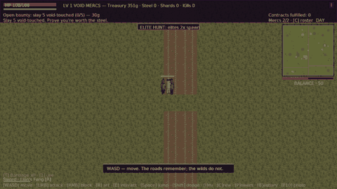
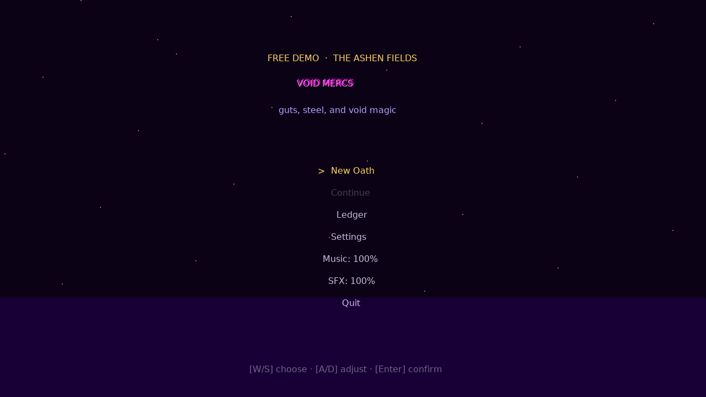
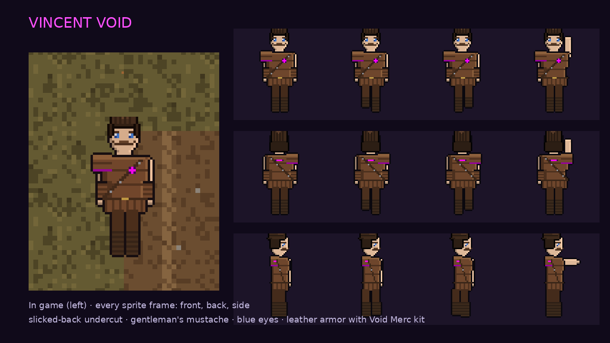
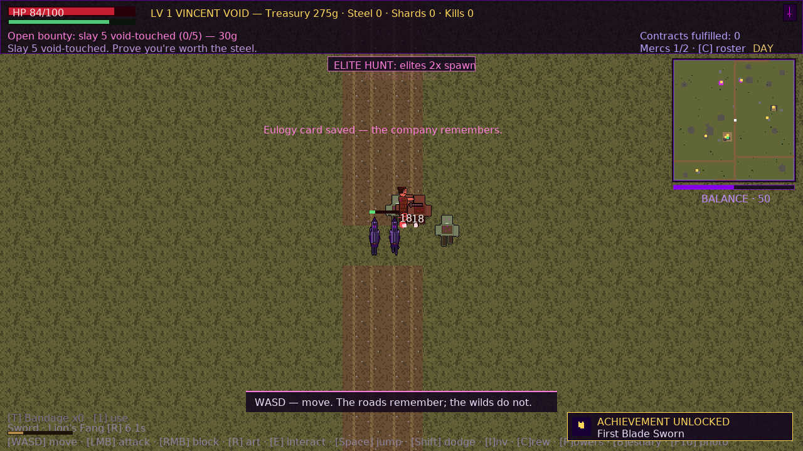
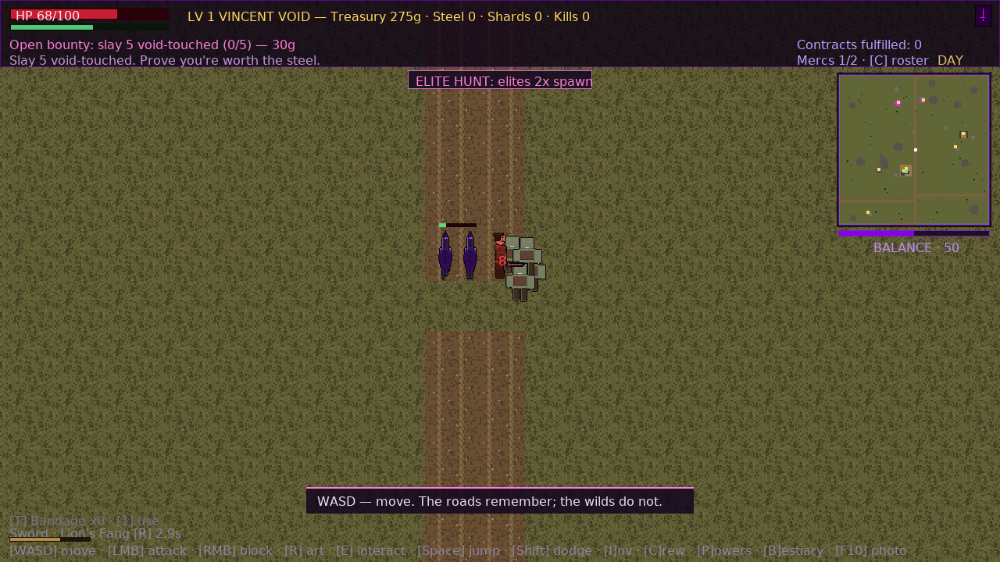
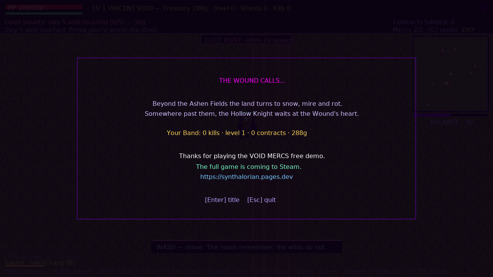
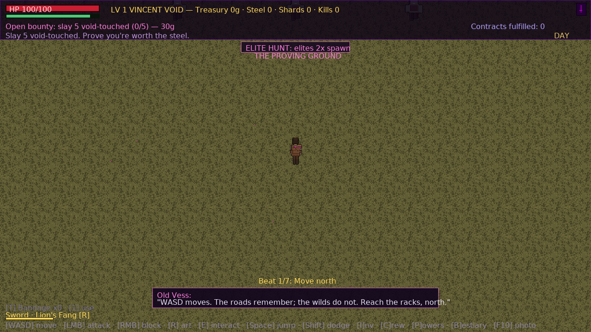

# VOID MERCS — Free Demo

**Guts, steel, and void magic.** A top-down mercenary action-RPG in a medieval
apocalypse. The void broke through, and the land reshapes itself around the
wound. You're **Vincent Void**: a mustached sellsword in Void Merc leathers, with
a ledger and a company to raise.

This free demo is **the Ashen Fields at company rank 1**: start a new run and
you're straight into the world as Vincent. Take bounties off the notice boards, loot the void-touched, hire your first
two blades, drink in the tavern, and hold the roads through the night. When
you're ready, take any pass out of the Fields... and **the Wound calls**.

> **The full game is coming to Steam.** Five more zones, rift dungeons, the
> arena, a company that grows into a Legion, and the Hollow Knight waiting at
> the Wound's heart. Follow along at **https://synthalorian.pages.dev**.

### ⚙️ Built on [VoidEngine](https://github.com/synthalorian/voidengine)
Void Mercs runs on **[VoidEngine](https://github.com/synthalorian/voidengine)**,
the open-source Odin + SDL2 engine (Apache-2.0). The engine is open; the game
itself is closed-source, and this repository hosts release builds only.



| | |
|---|---|
|  |  |
|  |  |
|  |  |

## What's in the demo

- The **Ashen Fields**, regrown fresh every run: roads, ruins, settlements, lairs, weather, day/night
- The Fields bestiary: **Husks, Raiders, Void Hounds**, night-time elites, blood moons
- Notice-board **contracts**, merchants, healers, chests, the **tavern** and its bard
- **Company rank 1**: hire up to two mercenaries (Sellsword, Archer, Battlemedic, Voidcaller)
- **Vincent Void**, the company's captain: slicked-back brown undercut, gentleman's mustache,
  blue eyes, leather armor under the Void Mercs kit. Paper-doll equipment, XP and skills, camp
- Taking any pass out of the Fields ends the demo

## Download & run

Get the zips from **[Releases](https://github.com/synthalorian/void-mercs-demo/releases)** (`v0.1.0-demo`). Check them against `SHA256SUMS.txt`.

**Windows x64**: unzip, then run `void-mercs-demo.exe`. Keep the DLLs and the `assets` folder next to it.
SmartScreen may warn that the app is unsigned. Choose *More info → Run anyway*.

**Linux x86_64**: install SDL2 and its add-on libraries, unzip, then run the launcher:

```sh
# Debian / Ubuntu
sudo apt install libsdl2-2.0-0 libsdl2-ttf-2.0-0 libsdl2-mixer-2.0-0 libsdl2-image-2.0-0
# Fedora
sudo dnf install SDL2 SDL2_ttf SDL2_mixer SDL2_image
# Arch
sudo pacman -S sdl2 sdl2_ttf sdl2_mixer sdl2_image

unzip void-mercs-demo-v0.1.0-demo-linux-x86_64.zip
cd void-mercs-demo-v0.1.0-demo-linux-x86_64 && ./void-mercs-demo.sh
```

Saves live in `~/.local/share/voidmercs-demo/` (Linux) or `%APPDATA%\voidmercs-demo\` (Windows).

## System requirements

- **OS:** Windows 10/11 64-bit, or a 64-bit Linux with glibc 2.34+ (e.g. Debian 12, Ubuntu 22.04+, Fedora 35+)
- **CPU:** any x86-64 dual-core
- **GPU:** anything with Direct3D 11 / OpenGL support (2D renderer, 1280×720 window)
- **RAM:** 1 GB · **Disk:** ~60 MB

## Controls

| Key | Action |
|---|---|
| **WASD** | move |
| **LMB** / **RMB** | attack / block |
| **Shift** / **Space** | dodge roll / jump |
| **E** | interact (boards, merchants, recruits, chests, passes) |
| **R** | weapon art |
| **T** | bandage |
| **I** / **C** / **P** / **B** / **M** | inventory / company roster / powers / bestiary / map |
| **F10** | photo mode |
| **Esc** | pause (save & quit to title) |

Gamepads are supported.

## Known issues (v0.1.0-demo)

- The Windows build was tested under Wine, not yet on native Windows. Please report problems.
- The builds are unsigned. Windows SmartScreen may warn on first launch.
- The Linux build uses the system SDL2 libraries, which you must install (see above).
- The title-screen ledger also lists full-game stats (bosses, rift waves, victories). In the demo they stay at 0.
- A first run writes a `console.log` to the save folder. Attach it when reporting a crash.

Report issues on this repo's [Issues](https://github.com/synthalorian/void-mercs-demo/issues) tab.

## License

**Free to play. All rights reserved.** No redistribution, re-uploading,
resale, or asset reuse; see [LICENSE](LICENSE). Streaming and videos are
welcome. Third-party components are listed in [ASSETS.md](ASSETS.md).

---

[VoidEngine (open source)](https://github.com/synthalorian/voidengine) · [synthalorian.pages.dev](https://synthalorian.pages.dev)
